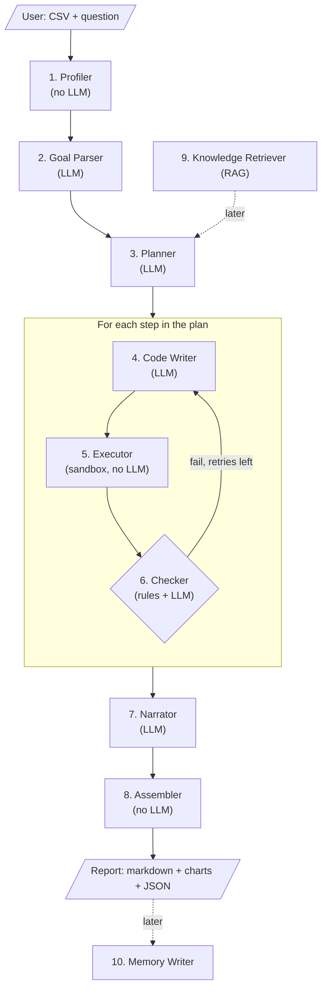
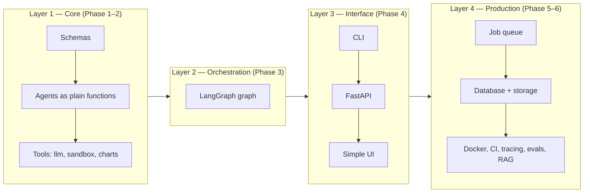

# 01 — Architecture

## 1. What the system does (one sentence)

The user uploads a **CSV** and asks a **question** in plain English. The system returns a
**report**: a short summary, charts, and insights where **every number is backed by real
computed results** (no made-up numbers).

Example:

```
Input : sales.csv + "Which region grew the fastest in 2024 and why?"
Output: report.md
        - Summary: "West grew fastest (+34% YoY) ..."
        - Chart: revenue by region by month
        - Insight 1: "West revenue went from $1.2M to $1.6M [m:step1.west_growth]"
        - Insight 2: ...
```

## 2. Core idea: LLM plans and writes, Python computes

LLMs are bad at arithmetic and good at planning and writing. So:

- **LLM** decides *what* to compute and writes the *pandas code*.
- **Python sandbox** runs the code and produces the *real numbers* (`metrics`).
- **LLM** writes the narrative, but may only cite numbers that exist in `metrics`.
- **A rule-based checker** (not an LLM) confirms every cited number really exists.

This is the single most important design idea. It is what makes the reports trustworthy.

## 3. The agents (8 core + 2 later)



| # | Agent | Uses LLM? | One-line job |
|---|-------|-----------|--------------|
| 1 | **Profiler** | No | Read the CSV, describe every column (type, nulls, min/max, samples). |
| 2 | **Goal Parser** | Yes | Turn the question into a structured goal (intent, columns, metrics, time range). |
| 3 | **Planner** | Yes | Break the goal into 1–5 small analysis steps. |
| 4 | **Code Writer** | Yes | Write pandas code for ONE step. Code must fill a `metrics` dict. |
| 5 | **Executor** | No | Run that code safely. Return metrics, tables, charts, errors. |
| 6 | **Checker** | Rules first, LLM optional | Did the step work and answer its question? If not → retry with feedback. |
| 7 | **Narrator** | Yes | Write summary + insights, citing metric keys like `[m:step1.west_growth]`. |
| 8 | **Assembler** | No | Verify citations, build the final report (Markdown + JSON). |
| 9 | Knowledge Retriever | Embeddings | *(Phase 6)* Pull domain hints ("churn = …") into the Planner. |
| 10 | Memory Writer | No | *(Phase 6)* Save good plans so future similar questions get better. |

Why fewer agents than before? The old design had 11 nodes, including separate "self_critic" and
"validator" nodes doing overlapping work. Now one **Checker** owns "is this step good?".
RAG is postponed because it only helps once the basic loop is solid.

## 4. The shared state

All agents read from and write to one typed object. Each agent returns **only the fields it
changed** (a partial update). That makes each agent easy to test alone.

```python
class RunState(BaseModel):
    # inputs
    run_id: str
    csv_path: str
    question: str

    # filled by agents, in order
    profile: DataProfile | None = None          # 1. Profiler
    goal: Goal | None = None                     # 2. Goal Parser
    plan: Plan | None = None                     # 3. Planner
    step_results: list[StepResult] = []          # 4–6. loop
    narrative: Narrative | None = None           # 7. Narrator
    report: Report | None = None                 # 8. Assembler

    # bookkeeping
    errors: list[str] = []
    cost_usd: float = 0.0
```

Full field definitions are in [02_agents.md](02_agents.md).

## 5. Layers (build from the inside out)



**Rule:** a layer may only call layers to its left. Agents never import FastAPI, Celery or a
database. This is why you can test every agent from a plain Python script.

## 6. Key design decisions (short ADRs)

| Decision | Choice | Why |
|---|---|---|
| Numbers come from | Executed code only | LLMs hallucinate numbers. Code doesn't. |
| Citation format | `[m:<step_id>.<metric_key>]` | Easy to verify with a regex. |
| Agent shape | `def agent(input: XIn) -> XOut` — pure function | Testable alone; LangGraph wraps it later. |
| LLM output | Always structured JSON → Pydantic model | Fails loudly if malformed; easy to diff. |
| Retry | Max 2 per step, with the error/feedback passed back | Fixes most code errors; bounded cost. |
| One LLM provider first | Pick one (Claude or OpenAI) behind a tiny wrapper | Fewer moving parts. Add a second one later if eval shows a benefit. |
| Sandbox | Subprocess + no secrets in env + import allowlist + timeout | LLM-written code is untrusted. |
| Prompts | Text files in `prompts/<agent>/v1.txt` | Versioned; you can compare v1 vs v2 in I/O logs. |
| Every run is saved | `runs/<run_id>/<agent>/input.json, output.json, meta.json` | This *is* your input/output analysis. |

## 7. Failure handling

| Failure | Who catches it | What happens |
|---|---|---|
| CSV can't be parsed | Profiler | Run stops with a clear error. |
| Question refers to a column that doesn't exist | Goal Parser | Returns `unknown_columns`; Planner avoids them; report says so. |
| Code crashes / times out | Executor → Checker | Checker sends the traceback back to Code Writer (retry ≤ 2). |
| Code runs but `metrics` is empty | Checker (rule) | Retry with "you must fill metrics". |
| Step still fails after retries | Checker | Step marked `failed`; other steps continue; report notes it. |
| Narrator cites a missing metric | Assembler (rule) | Sentence removed or flagged; counted in eval as a hallucination. |
