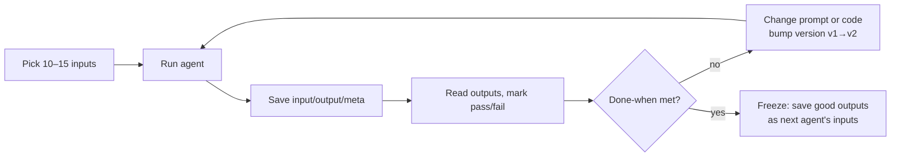

# 05 — Input → Output Analysis (how to test each agent)

This is how you build trust in each agent before connecting them.

## The loop (for every agent)



## 1. Test data (make once, use forever)

Put these in `fixtures/data/`. Small, realistic, and you know the right answers.

| File | Rows | Columns | Why |
|---|---|---|---|
| `sales.csv` | ~1,000 | date, region, product, units, revenue | Trends, comparisons, growth |
| `churn.csv` | ~500 | customer_id, plan, tenure_months, monthly_fee, churned | Rates, segments |
| `messy.csv` | ~200 | dates as text, 15% nulls, `"$1,200"` strings, a duplicate column name | Robustness |
| `tiny.csv` | 3 | a, b | Edge case |
| `wide.csv` | 100 | 50 columns | Prompt size / column selection |

**Tip:** generate `sales.csv` and `churn.csv` with a small script and plant known facts
(e.g. "West grows 34% in 2024", "monthly plan churns 3× more"). Then you *know* the right
answer and can check the agents objectively.

## 2. Question set

`fixtures/questions.yaml` — 15 questions with your expected answer:

```yaml
- id: q01
  csv: sales.csv
  question: "Which region grew the fastest in 2024?"
  expected:
    intent: compare
    columns: [region, revenue, date]
    answer_contains: ["West", "34"]
- id: q02
  csv: sales.csv
  question: "how are we doing?"          # vague
  expected:
    ambiguous: true
- id: q03
  csv: churn.csv
  question: "What is our profit margin?"  # column doesn't exist
  expected:
    unknown_columns_not_empty: true
```

Mix: 8 clear · 3 vague · 2 wrong-column · 2 multi-part.

## 3. What gets saved for every agent call

```
runs/
  2026-11-21_q01_a1b2/
    profiler/      input.json  output.json  meta.json
    goal_parser/   input.json  output.json  meta.json
    planner/       ...
    code_writer/step1_try1/ ...
    executor/step1_try1/    ... + chart.png
    ...
    report.md
```

`meta.json`:
```json
{
  "agent": "goal_parser",
  "prompt_version": "v2",
  "model": "<model id>",
  "input_tokens": 812,
  "output_tokens": 143,
  "cost_usd": 0.0031,
  "latency_ms": 1840,
  "ok": true,
  "error": null
}
```

## 4. Running one agent alone

```bash
# run one input
python -m insight_agent.agents.goal_parser --input fixtures/goal_parser/q01.json

# run all fixtures for one agent and write a summary table
python -m insight_agent.tools.batch --agent goal_parser --fixtures fixtures/goal_parser/
```

The batch script prints and saves a table like:

| id | ok | intent | target_columns | unknown | tokens | ms | your verdict |
|---|---|---|---|---|---|---|---|
| q01 | ✓ | compare | region, revenue, date | – | 955 | 1840 | ✅ |
| q02 | ✓ | summary | revenue | – | 901 | 1610 | ❌ should be ambiguous |

You fill the last column. That table **is** your I/O analysis.

## 5. What to look for, per agent

| Agent | Look for |
|---|---|
| Profiler | Wrong dtype (dates as text, numbers as text), null % correct, speed |
| Goal Parser | Invented columns, wrong intent, vague questions not flagged |
| Planner | Too many steps, steps that don't help answer, missing obvious step |
| Code Writer | Runs? Fills `metrics` with the expected keys? Uses right columns? Handles nulls? |
| Executor | Timeouts, blocked imports, secrets not visible, output caps work |
| Checker | False "pass" (bad result accepted), false "retry" (good result rejected) |
| Narrator | Invalid citations, numbers without citations, doesn't answer the question, too long |
| Assembler | Citation replacement correct, markdown renders |

## 6. Unit tests vs I/O analysis

| | Unit tests (`tests/`) | I/O analysis (`runs/` + logs) |
|---|---|---|
| For | Non-LLM logic (Profiler, Executor, Checker rules, Assembler) | LLM agents |
| LLM | Never (use `FakeLLM`) | Real LLM |
| Runs | Every commit, in CI | By hand when you change a prompt |
| Result | pass/fail | A table you read and judge |

Later (Phase 6), the I/O analysis turns into the automatic **eval harness**: the same
fixtures, the same table, but scored by code and logged per prompt version.
